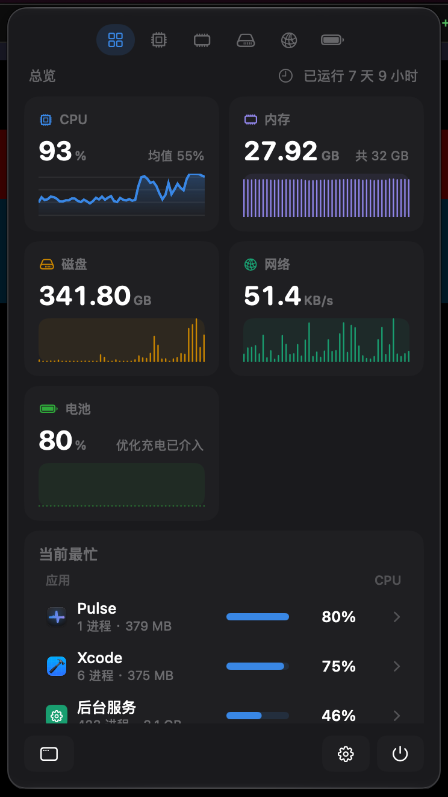
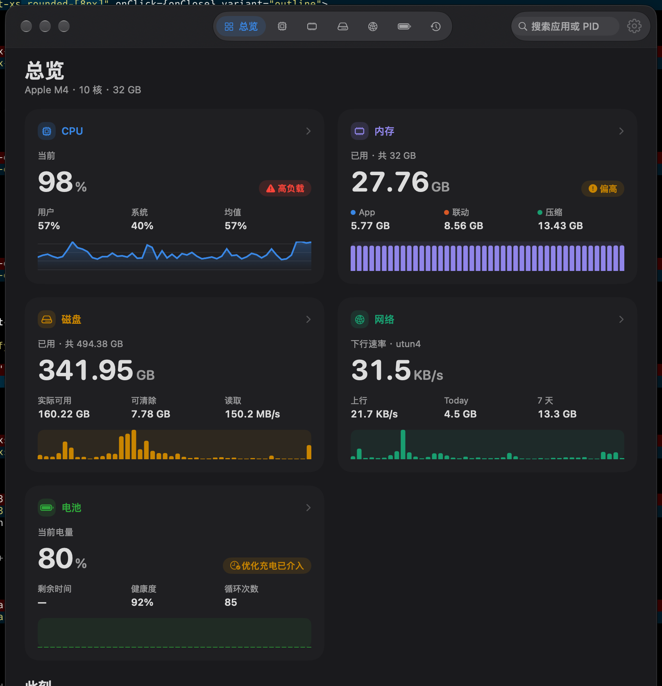
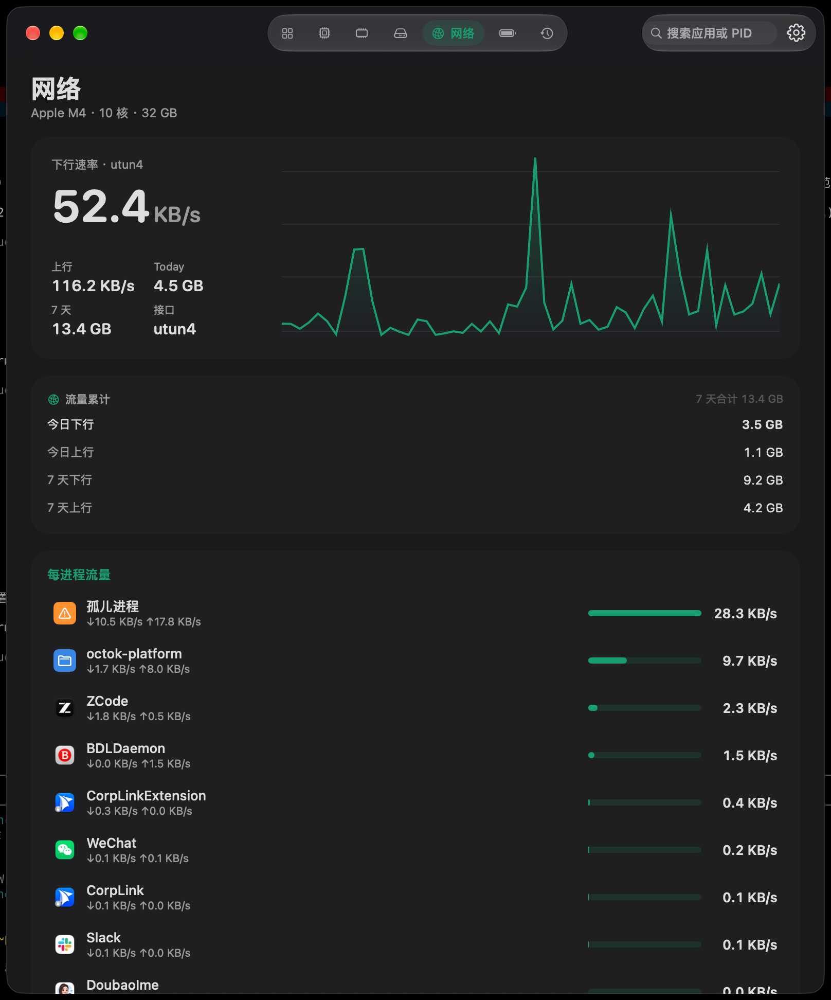
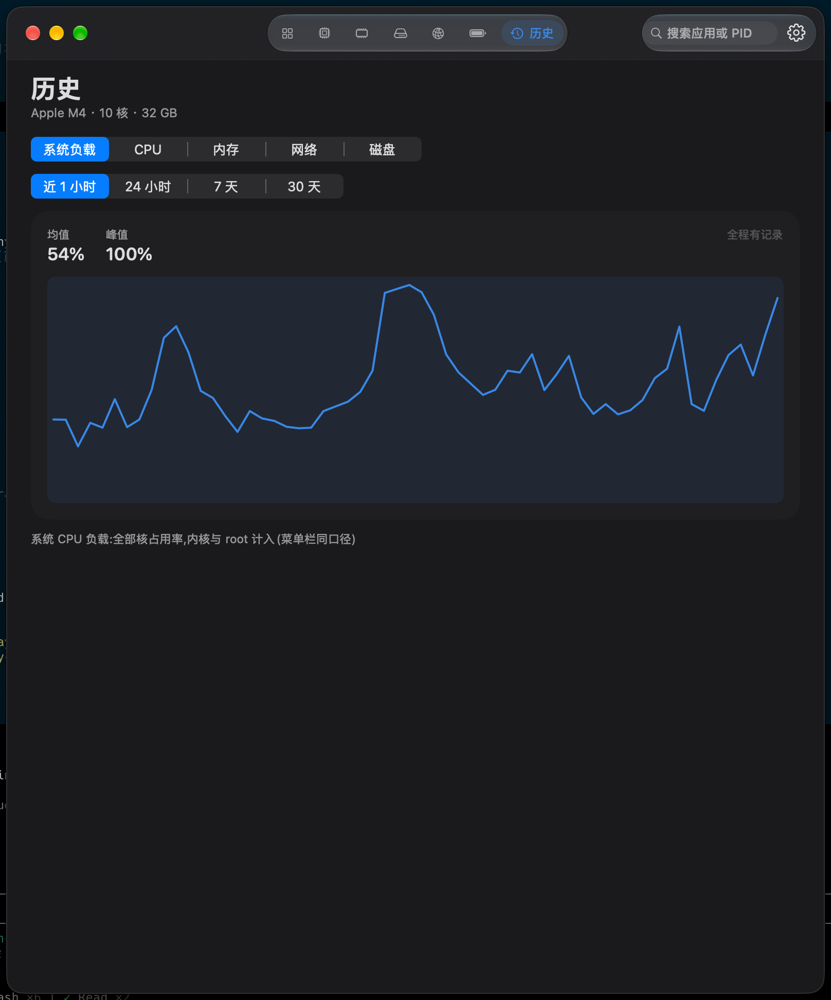
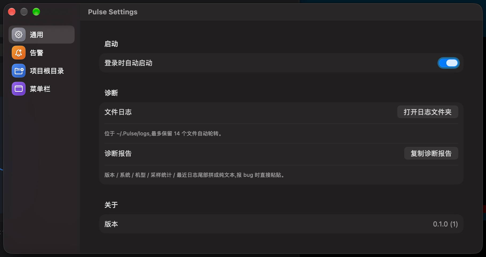

# Pulse

[English](README.md) | **简体中文**


macOS 菜单栏系统监视器,回答活动监视器不回答的问题:**到底是谁在吃我的机器?**不是一千行进程列表,而是应用分组、项目级归因,和那一个真正该背锅的进程——连它的 cwd 和完整 argv 都给你。

<p align="center">
  
  
</p>

## 为什么写 Pulse

> 2026-10-12 那次 load 52 的真相:同一个仓库的两个 worktree 同时跑质量门禁(`cargo test` + `vitest --coverage`)+ 一个常驻 App 白烧 60% 一核 + OrbStack VM 86%。
>
> 活动监视器只会给你 1000 行进程列表;Pulse 把它归成三行,每行都能下钻到进程树、启动时间、cwd、完整 argv。

Pulse 以 [Vitals](https://vitalsmac.com) 为界面与数字口径基准,并在它没做深的方向上做深——**项目 / 会话级归因**。

## 功能

### 菜单栏,常驻

读数槽位可配置——CPU / 内存 / 磁盘 / 网络四选一,1–3 个槽。数字随内存压力变色,CPU 超 70% 变红。

<p align="center"></p>

### 弹窗:一眼看全

点开徽标即见五大域——CPU、内存、磁盘、网络、电池,带走势微图,以及当下最忙的应用分组。列出全部进程组,不做 Top-5 截断。

### 主窗口:七个模块页

总览 / CPU / 内存 / 磁盘 / 网络 / 电池 / 历史,药丸标签切换;工具栏按应用名或 PID 搜索;进程表可排序;分组可下钻;确认后可结束整组 / 结束进程树。

<p align="center"></p>

每个模块页带排行卡,直接指出**责任者**:每进程磁盘读写、每进程流量(经系统 `nettop` 工具读取——没有公开 API 可用)、电池能耗影响。

### 磁盘,按 APFS 的口径

容器级容量、各卷明细、可清除空间、本地快照——和 Finder 同一套语义,不是天真的 `statfs`。

### 30 天历史

所有指标落本地 SQLite(GRDB)。系统负载、CPU、内存、网络、磁盘,近 1 小时 / 24 小时 / 7 天 / 30 天随时回看。

<p align="center"></p>

### 归因引擎(最好玩的部分)

三层,依次兜底:

1. **Bundle 归属**——进程归到应用名下,Helper / XPC 子进程一并跟随;
2. **父链上溯 + 出生登记**——中间进程死了,链条也不断;
3. **项目根匹配**——在设置里配置项目根,按 cwd / argv 匹配;git worktree 显示为 `项目名 @ worktree`。

剩下谁都不认的,是**孤儿进程**,橙色高亮——它往往正是你要找的那个。

### 不轰炸的告警

五个内置预设:持续系统负载、应用组 CPU 超标、新分组吃内存、可用磁盘不足 20 GB,以及*闲置的 dev server*。迟滞带 + 按种类冷却,不会在阈值附近连环轰炸。点通知直达主窗口;通知被拒时给「打开系统通知设置」一键入口。

dev server 盘点器从 argv 识别 vite / next dev / webpack-dev-server / tsc · vitest · jest · pytest watch / django runserver / bun dev / cargo watch,探测端口,标记闲置约 10 分钟的实例。只盘点、不代杀。

### 设置

登录自启、菜单栏槽位、项目根目录、文件日志(`~/.Pulse/logs`,自动轮转),以及一键复制诊断报告(报 bug 直接贴)。

<p align="center"></p>

## 资源预算

给真正在干活的机器用:

- 全程用户态 API——`proc_listallpids` / `proc_pidinfo` / `host_processor_info` / `host_statistics64`——**无 root**,无内核扩展;
- 自适应采样:弹窗打开 1 秒,其余 5 秒;
- 空闲成本约一核的 1%(实测);
- 日志写 `~/.Pulse/logs`,自动轮转。

## 从源码构建

环境要求:macOS 26+、Xcode 26(Swift 6 工具链)、[XcodeGen](https://github.com/yonaskolb/XcodeGen)。

```bash
git clone https://github.com/GaoZimeng0425/pulse.git
cd pulse
xcodegen generate        # 由 project.yml 生成工程,勿手改 pbxproj
open Pulse.xcodeproj     # 然后 Run(⌘R)
```

开发时建议:

```bash
sh .githooks/install.sh  # 提交闸门:staged 含 Swift 即增量构建,失败拦截
sh scripts/check.sh      # 全量检查:构建 + 全部 535 个单元测试
sh scripts/test.sh --only SomeTests  # 只跑单个套件
```

## Roadmap

按权限门槛分阶段,免 root 的先做:

- **P2** — GPU / 神经网络引擎 / 温度风扇 / 声音 / 蓝牙 / 容器卡(全部免 root)
- **P3** — root helper(每 App 能耗 / GPU / 网络归因)+ MCP server,让 AI 直接问 `why_cpu_high()`

## 参考与致谢

- **UI 形态与数字口径基准**:[Vitals](https://vitalsmac.com)(闭源,仅做行为对齐,未接触其代码)
- **算法参考(MIT,移植处已在文件头注明)**:[exelban/stats](https://github.com/exelban/stats)(GPU/ANE/SMC/网络/电池)、[henrydennis/petal](https://github.com/henrydennis/petal)(APFS 容器级容量)、[jithin-sabu/purge-app](https://github.com/jithin-sabu/purge-app)(产物目录学与活跃度判定)
- **点子参考(未使用其任何代码)**:[tw93/Mole](https://github.com/tw93/Mole)(GPL-3.0)

## 许可证

Pulse 以 [MIT 许可证](LICENSE)发布。上文致谢的第三方算法移植部分沿用其各自的 MIT 条款,在使用处的文件头有注明。
